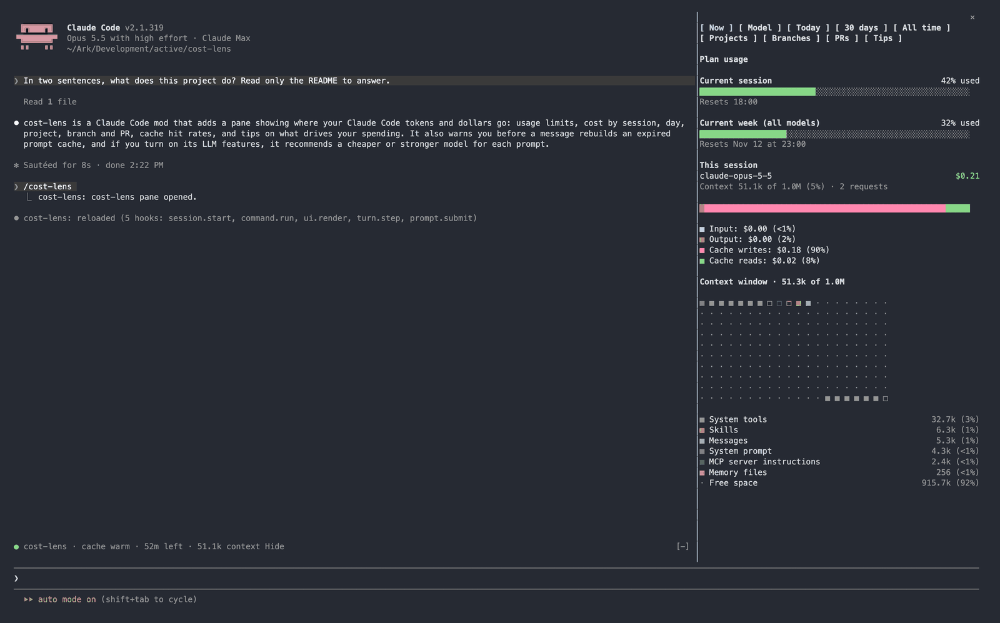
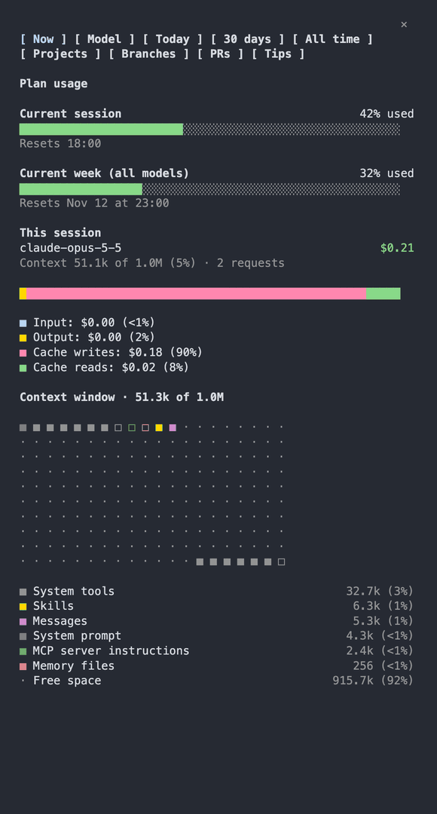
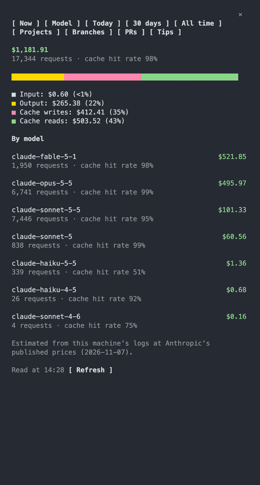
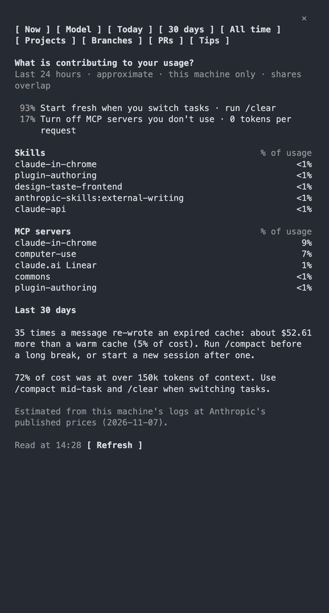
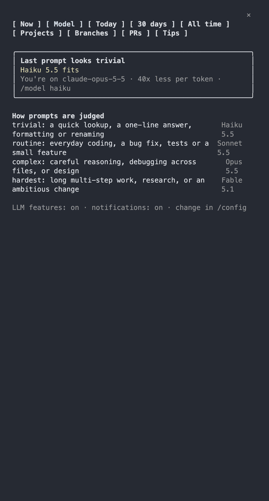

# cost-lens

A Claude Code mod that shows where your Claude Code tokens and dollars go, warns before a message rebuilds a cold prompt cache, and can recommend the model that fits each prompt.



## Install

Requires Claude Code 2.1.319 or later, Node.js 22.18 or later on your `PATH`, and, for the PRs tab, the GitHub CLI (`gh`). Built and tested on macOS.

At the prompt of a Claude Code terminal session:

```
/plugin install cost-lens --marketplace ZachFara/cost-lens
```

Answer `y` to add the marketplace, then pick a scope (user scope loads it in every session). From a shell instead:

```sh
claude plugin install cost-lens --marketplace ZachFara/cost-lens
```

In the desktop app, where `/plugin` does not run: click + next to the prompt box, then Plugins, Add marketplace with `ZachFara/cost-lens`, then Add plugin.

Then type `/cost-lens` to open the pane. Click a tab, or give the pane the keyboard with `ctrl+x tab` (twice while the cache line shows above the prompt: the first press goes to that line) and press `1` to `9`. In Claude Code's fullscreen layout (`/tui fullscreen`) it docks beside the chat; otherwise it opens above the prompt.

## What it shows

- **Model**: the model that fits your last prompts (needs LLM features, below), recent recommendations and how prompts are judged.
- **Now**: your plan's usage limits (as `/usage` shows them), this session's model, cost, cost split and context.
- **Today**, **30 days**, **All time**: total cost, cache hit rate, cost by category and by model.
- **Projects**, **Branches**, **PRs**: where the last 30 days went, and what each branch and pull request of the current repository cost.
- **Tips**: what drives your usage in the last 24 hours, and the cost of expired-cache rebuilds and large context in the last 30 days.
- A line above the prompt with the prompt cache's state, a warning when a message re-writes an expired cache, and, with LLM features on, a model recommendation for each prompt (Haiku, Sonnet, Opus or Fable, by how hard the task looks), shown in the Model tab and, optionally, as a notification.

## Screenshots

A tour of the tabs (project names on the Projects tab are blurred here):



| All time                                                                    | Tips                                                                     | Model                                                               |
| --------------------------------------------------------------------------- | ------------------------------------------------------------------------ | ------------------------------------------------------------------- |
|  |  |  |

## Settings

In `/config`, under cost-lens (or when installing):

| Setting                            | Default | What it does                                                                                                                                                               |
| ---------------------------------- | ------- | -------------------------------------------------------------------------------------------------------------------------------------------------------------------------- |
| Allow LLM features                 | off     | Lets a small Claude model (Haiku) read the text of each prompt you type of 40 characters or more, to recommend a model. Off: cost-lens sends none of your data to a model. |
| Model recommendation notifications | on      | With LLM features on, a notification when the model that fits a prompt differs from the one in use (at most every 10 minutes).                                             |

Costs are estimates from the session logs Claude Code keeps on your machine (`~/.claude/projects`), priced with Anthropic's published prices. Nothing leaves your machine except the pricing page download and, only with LLM features on, the model recommendation's classification request (one small-model call per prompt of 40 characters or more).

## Load from a working copy instead

Point Claude Code at this folder in `~/.claude/settings.json`:

```json
{ "env": { "CLAUDE_CODE_PLUGIN_DIRS": "~/path/to/cost-lens/plugin" } }
```

Every new session then loads the mod; type `/cost-lens` to open the pane.

## Develop

```sh
npm install        # also installs the git hooks
claude --plugin-dir plugin   # once, so Claude Code writes its mod API types
npm run engine-types    # copy them into vendor/ (gitignored)
npm run check      # everything CI runs
claude --plugin-dir plugin   # try the mod in a session
```

Agents: start with `AGENTS.md`.

## License

MIT. See `LICENSE`.
